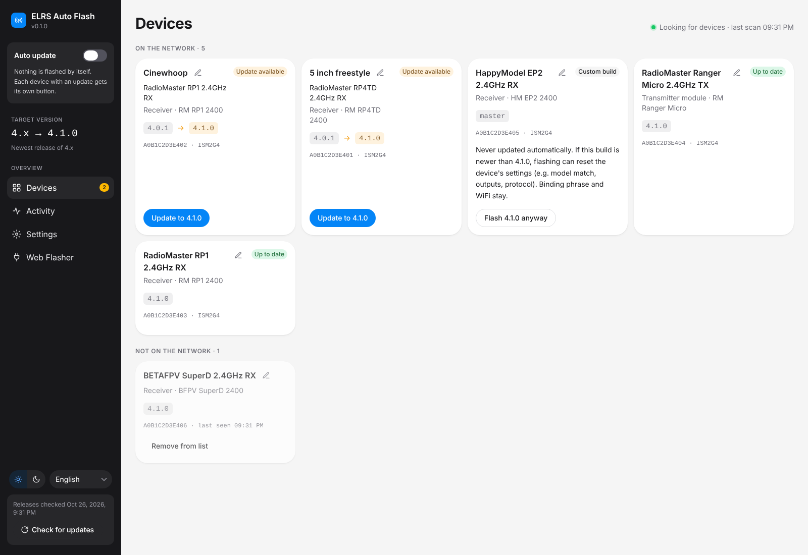
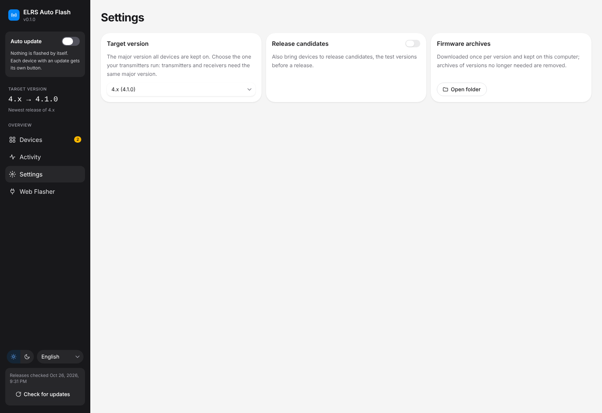
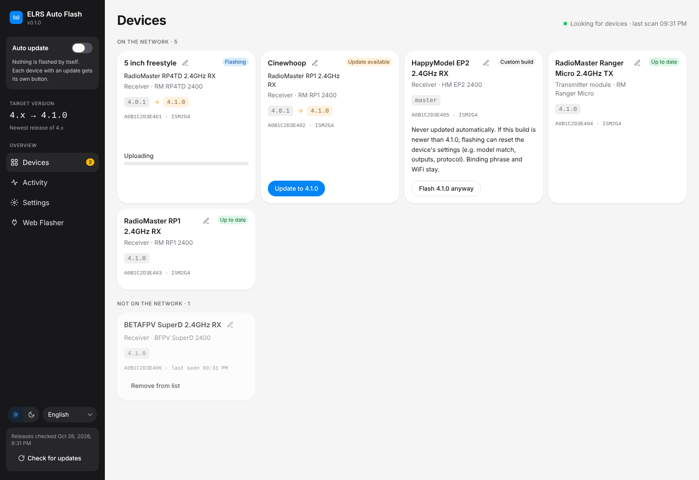
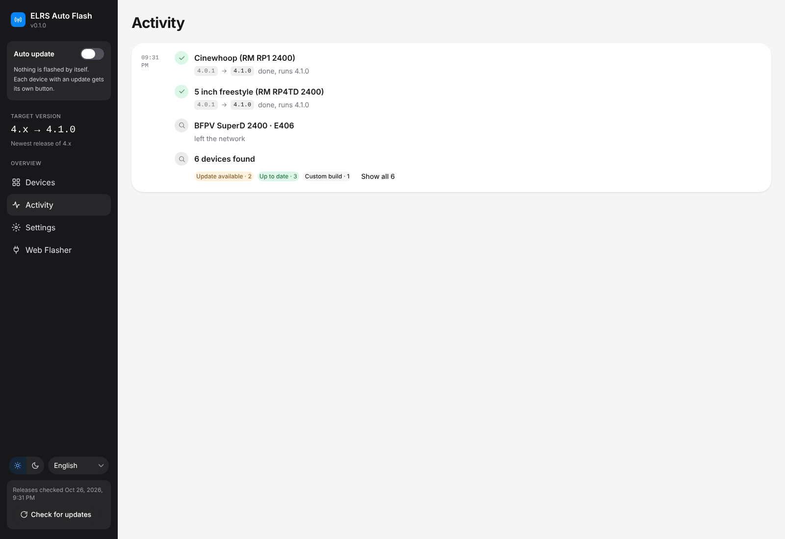
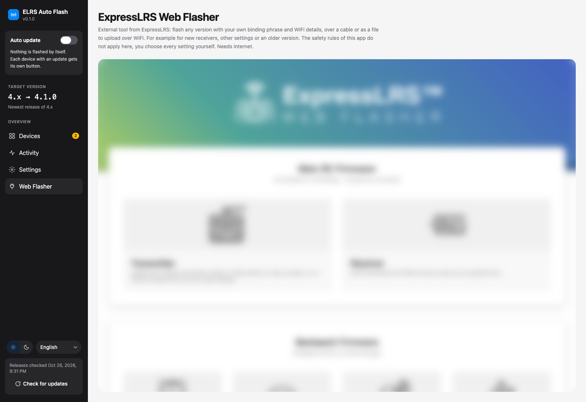

# ELRS Auto Flash

Keep your ExpressLRS receivers and transmitter modules up to date without updating each one by hand. Devices that join your home WiFi are found automatically and updated to the current firmware over the network, keeping their binding phrase, regulatory domain and WiFi settings.

Desktop app for macOS, Windows and Linux, in English and German (chosen at the bottom of the sidebar). For advanced use, a [browser interface](docs/browser-interface.md) and a [command line tool](docs/command-line.md) are available when running from source.

**Early version:** finding devices, showing which ones have an update, updating on request and auto update all work. The app builds the same firmware file as the ExpressLRS tools and has been tested on a RadioMaster RP4TD (ESP32 receiver), a RadioMaster RP1 (ESP8285 receiver) and a transmitter module.

## What it does

- **Finds your devices** on the home WiFi, also where mDNS is blocked, and shows each one with its firmware version and whether an update is available.
- **Updates them over WiFi**, with one click per device, or automatically with auto update on: as soon as a newer version is out, each device is updated the next time it shows up.
- **Keeps your settings**: binding phrase, regulatory domain, WiFi and the other options stay as they are.
- **Keeps the link**: all devices stay on the major version you choose (for example 3.x), so receivers and radios keep working together.
- **Includes the ExpressLRS Web Flasher** for everything else: any version, your own binding phrase, flashing over a cable.

It is careful by design:

- Until you have chosen the target version once, devices are only listed, not updated.
- Only stable versions are installed, unless you turn on release candidates.
- The app never takes a device back to an older version.
- A custom build (one that reports a branch name instead of a version) is only flashed when you click "Flash … anyway" on it.
- Firmware that a device reports as not matching its hardware is never forced onto it.

## Install

Download the app from the [Releases](https://github.com/Mariator-pro/elrs-auto-flash/releases) page:

- **macOS**: `elrs-auto-flash-macos-arm64-v<version>.zip` for Apple Silicon (M1 and newer) or `elrs-auto-flash-macos-x64-v<version>.zip` for Intel Macs. Unzip it, open the `.dmg` inside and drag the app into Applications.
- **Windows**: `elrs-auto-flash-win64-v<version>.zip`. Unzip it and run the installer inside.
- **Windows, portable**: `elrs-auto-flash-win64-portable-v<version>.zip`, no installation. Unzip it into a folder of its own (the files are at the top of the zip) and start `ELRS Auto Flash.exe`. Settings and known devices go to the same folder as with the installed app.
- **Linux** (x64): `elrs-auto-flash-linux-v<version>.zip`. Unzip it and start the `.AppImage` inside, for example with a double click or `./elrs-auto-flash-linux-v<version>.AppImage`. If it does not start, the system may lack FUSE 2: on Ubuntu 24.04 and newer install it with `sudo apt install libfuse2t64`, on older Ubuntu and Debian with `sudo apt install libfuse2`.

The app is not signed with an Apple or Microsoft certificate, so the system warns on first start:

- **macOS**: the first start shows "Apple could not verify ... is free of malware". Click "Done" (not "Move to Trash"), open System Settings, Privacy & Security, scroll down and click "Open Anyway" next to the blocked app, confirm with your password or Touch ID, then start the app again and choose "Open". Later starts need nothing.
- **Windows**: if a SmartScreen window appears, click "More info" and then "Run anyway".
- **Linux**: no warning. If the file manager does not start the AppImage, mark it as executable (`chmod +x`).

Signing the Windows version is applied for at the SignPath Foundation, see [Code signing policy](#code-signing-policy).

The app needs the local network to find devices:

- **macOS** asks on first start whether ELRS Auto Flash may find devices on the local network. Allow it; if you said no, turn it on in System Settings, Privacy & Security, Local Network, and start the app again.
- **Windows** may ask whether ELRS Auto Flash may use the network (Windows Defender Firewall). Allow it for private networks.

### Updating the app

On start the app looks for a newer release and shows it at the top left:

- **Windows (installed) and Linux**: "Update and restart" downloads the new version, installs it in place and starts it again. Your data and settings stay.
- **Windows (portable)**: "Download" opens the release page; unzip the new version and delete the old folder.
- **macOS**: "Download" opens the release page. Install the new version like the first one; the app replaces the old one in Applications. macOS accepts an in-place update only for apps signed with an Apple certificate, which this one is not.

## Using it

### 1. Choose the target version

On first start the Devices page asks you to choose a target version. Open "Settings" and pick the major version your radios run: radios and receivers need the same major version. Until then, no device is updated. When a newer major version comes out, the Devices page tells you; switch in the settings once your radios run it.

### 2. Bring your devices onto the network

A device is only on the network while its WiFi is on:

- **Receiver**: power it with the radio off and wait about a minute, the "WiFi on interval" (60 seconds by default).
- **Transmitter module**: turn on WiFi in the ELRS Lua script on the radio.

To join your home network instead of opening its own network ("ExpressLRS RX" or "ExpressLRS TX"), a device needs your home network set up once on its web page. For a new device that does not know your home network yet, use the [Web Flasher](#6-web-flasher).

### 3. Devices

The Devices page keeps looking for devices and shows each one as a card with its version, the target version and its status: up to date, update available, newer than the target version, custom build or not supported (below ExpressLRS 3.0). Devices found before that are not on the network right now are listed below the others with the time they were last seen; "Remove from list" removes one you no longer own (it is added again when it is found).

- **Update**: with auto update off, start each update with "Update to …" on the device. A custom build gets a "Flash … anyway" button, with a note on what flashing it can reset.
- **Names**: devices of the same kind share one name (the one the ELRS Lua script shows, e.g. RM RP4TD 2400). The pencil next to the name gives a device its own name, e.g. "5 inch freestyle"; without one, the last 4 digits of its MAC tell them apart.
- **Notices**: a device whose firmware did not match its target, or that failed 3 times, shows a notice. Check the device, then click "Allow again" (with auto update on, the update starts again right away). A single attempt that stopped or failed shows on the card until the next one.

After the upload the device restarts and counts as done once it shows up again with the new version. A receiver comes back by itself while the radio stays off. A transmitter module restarts with its WiFi off: turn it on again in the ELRS Lua script to confirm the update.

### 4. Auto update

The "Auto update" switch at the top of the sidebar decides whether updates start automatically:

- **On**: every device with an update is updated as soon as it shows up, one at a time. A failed upload is tried again after about a minute, at most 3 times per version.
- **Off** (the default): you start each update yourself with "Update to …" on the device.

Custom builds, devices newer than the target version and devices without a target version are never updated by auto update. Auto update only runs while the app is open. Closing the window quits the app; while a device is updating it asks first (a device cut off keeps its old firmware and gets the update next time).

### 5. Activity

The Activity page lists what happened since the start, grouped by minute. An update takes one line with the old and the new version. Devices that did the same at once (all found at the start, or after a new target version) share one line that opens up.

### 6. Web Flasher

The Web Flasher page shows the [ExpressLRS Web Flasher](https://expresslrs.github.io/web-flasher/) inside the app, for everything this app leaves out on purpose: any version including older ones, with your own binding phrase and WiFi details, flashed over a cable or saved as a file to upload over WiFi (for example a new receiver that does not know your home network yet). The safety rules of this app do not apply there, you choose every setting yourself. It needs an internet connection. Once a device knows your home network, it shows up under Devices and is kept up to date over WiFi.

In the app:

- Flashing over a cable works without Chrome or Edge: when the Web Flasher connects, the app asks which port the device is on.
- Files the Web Flasher saves (firmware file, Lua script) go to the Downloads folder, which then opens with the file selected; any other file is saved only where you choose. Links to guides open in your browser.
- Flashing STM32 devices with an ST-Link does not work in the app; use the [browser interface](docs/browser-interface.md) in Chrome or Edge for that.
- The binding phrase and WiFi details you type in are deleted when the app quits, unless you turn on "Remember Web Flasher entries" in the settings (then they stay on the computer unencrypted, as in a browser).

### 7. Settings

- **Target version**: the major version all devices are kept on (see [step 1](#1-choose-the-target-version)).
- **Release candidates**: devices also get release candidates, the test versions before a new version comes out. They can have bugs; turning this off later doesn't take any device back to an older version.
- **Firmware archives**: the firmware of each version is downloaded once (about 30 MB) and kept on the computer; archives of versions no longer needed are removed. "Open folder" shows them.
- **Remember Web Flasher entries**: see [Web Flasher](#6-web-flasher).

"Check for updates" at the bottom of the sidebar asks GitHub for new ExpressLRS versions right away; otherwise the app does this by itself every 6 hours. Appearance (light or dark) and language are chosen there as well.

## Your data on the computer

Settings, the last list of versions, the known devices and the firmware archives are kept in:

- macOS: `~/Library/Application Support/ELRS Auto Flash/`
- Windows: `%LOCALAPPDATA%\ELRS Auto Flash\`
- Linux: `~/.local/share/elrs-auto-flash/` (or `$XDG_DATA_HOME`)

## More documentation

You do not need any of this to use the app. It is for those who want to go further:

- [Browser interface](docs/browser-interface.md): the same pages as the desktop app, in your web browser
- [Command line](docs/command-line.md): finding, updating and watching devices from the terminal
- [Development](docs/development.md): running from source, building the app and making a release

## Code signing policy

Free code signing provided by [SignPath.io](https://about.signpath.io), certificate by [SignPath Foundation](https://signpath.org).

The Windows version is not signed yet: the application to the SignPath Foundation is pending. Once accepted, every Windows release is built by GitHub Actions from the source code in this repository and signed only after a manual approval.

- Committers and reviewers: [Mariator-pro](https://github.com/Mariator-pro)
- Approvers: [Mariator-pro](https://github.com/Mariator-pro)

### Privacy policy

The app doesn't collect or send any personal data, settings or device information to the developer or to anyone else. To do its job it connects to:

- devices on your local network, to find ExpressLRS receivers and transmitter modules and update them
- GitHub (api.github.com, github.com), to look up ExpressLRS versions and a newer version of the app itself, each time the app starts
- the ExpressLRS firmware archive (artifactory.expresslrs.org), to download firmware when a device is updated
- the ExpressLRS Web Flasher (expresslrs.github.io), only when you open the "Web Flasher" page

See the [GitHub Privacy Statement](https://docs.github.com/site-policy/privacy-policies/github-general-privacy-statement) for what GitHub records about these requests.

## License

MIT, see [LICENSE](LICENSE).
